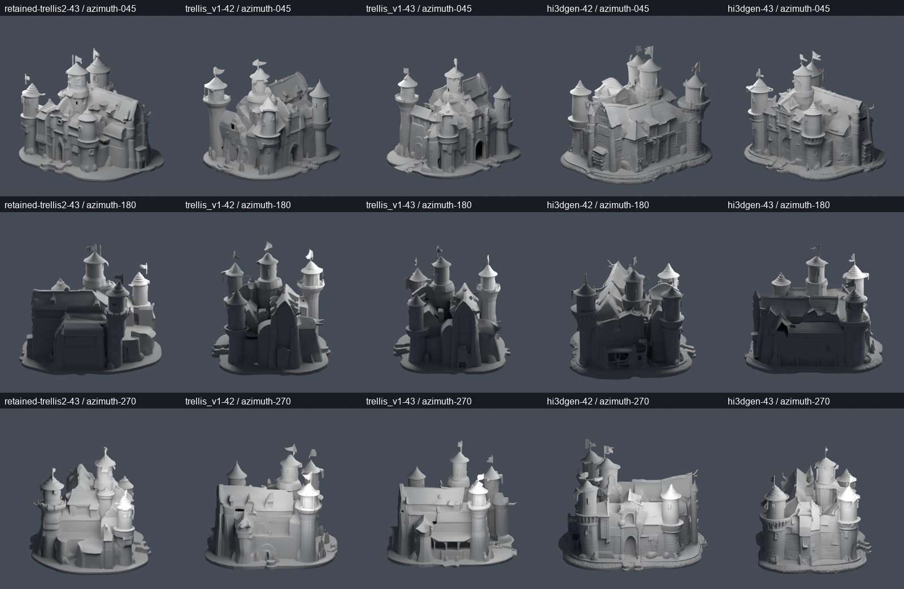

# Castle geometry benchmark - 2026-10-23

The existing local TRELLIS v1 and Hi3DGen environments each generated two real
castle meshes, seeds 42/43, sparse 50 / SLAT 24 steps, stage CPU offload and the
same retained RGBA. No installs, downloads, source patches or production engine
promotion were made. The actual learned normal-estimator stage is included for
Hi3DGen. The shared one-heavy-GPU resource lock and conservative host-RAM
admission were used. This is geometry-only research; PBR generation is absent.

Input mask comes from the retained evaluation-only TRELLIS.2 castle run:
`.local/castle-quality-route/20261022T132736Z/Library/jobs/5eff3892f4154fe8a1091ce5d981cb4d/output/source_alpha.png`.
That lineage is not new commercial clearance. The original concept, mask,
conditioning, source report and retained TRELLIS.2 GLB hashes remained unchanged.
Engine/core dependency and original StableNormal/YOSO licensing findings remain
in [the engine research audit](ENGINE_RESEARCH_V2.md).

## Measured outputs

| Engine / seed | Worker duration | Triangles | Torch allocated peak | Sampled entire-GPU peak |
| --- | ---: | ---: | ---: | ---: |
| TRELLIS v1 / 42 original | 48.74 s | 1,269,640 | 7,902,098,944 B | unavailable, see below |
| TRELLIS v1 / 43 | 38.80 s | 1,231,654 | 7,870,498,816 B | 14,594 MiB |
| Hi3DGen / 42 | 71.41 s | 1,059,520 | 7,808,932,864 B | 12,999 MiB |
| Hi3DGen / 43 | 38.61 s | 1,048,406 | 5,611,899,392 B | 9,844 MiB |
| TRELLIS v1 / 42 supplemental repeat | 42.56 s | 1,269,620 | 7,902,098,944 B | 14,741 MiB |

Durations are real worker reports, including model loads and export; host
inspection/rendering are separate. RAM, GPU utilization and whole-device VRAM
were sampled at approximately one-second intervals. Whole-device values include
desktop/other activity and can miss transients. Cache/order and different
architectures preclude a controlled speed ranking. All GLBs are finite/nonempty
and reopen through the actual API validator. The material inventory correctly
reports no PBR images/UV, not successful textured production assets.

The first original v1 worker completed, but API inspection stalled in Trimesh's
quadratic no-SciPy normal fallback. Its research parent was terminated to correct
the inspector, losing that case's in-memory whole-GPU samples. Original Torch
peaks and neural files survived. The repaired inspector reused that GLB in 1.75 s
without inference or hash changes; see [the fix](MISSING_NORMALS_QA.md).

The separate supplemental repeat measures the same v1 configuration's resource
use; it is **not** a retroactive measurement of the original. It differs by 20
triangles and has a different GLB hash. Seed equality does not establish
bit-identical output; the cause of this small difference has not been isolated.
Both immutable attempts are retained. 14,741 / 16,303 MiB leaves limited VRAM
headroom, and this does not authorize increasing GPU concurrency.

## Direct geometry observations

Blender CPU Cycles rendered **50 actual frames**: eight azimuths through 360
degrees plus top/bottom for the retained TRELLIS.2 baseline and four new meshes.
All use neutral clay, the same lights, orthographic camera, 512-square resolution
and 16 samples. Each is explicitly scaled to a 10 m diagnostic height only in
the render scene; source GLBs remain unchanged and game dimensions unapproved.
The same neutral shader deliberately removes PBR appearance from this comparison.

Visual observations, without an artistic score or user approval:

- The retained TRELLIS.2 result has a more coherent overall silhouette in the
  inspected views, with smooth fine detail and an invented back.
- V1 reconstructs a recognisable castle but has broad/smoothed planes, roof and
  rear-wall changes, plus seed-dependent openings. More triangles do not make
  these results automatically better than the retained baseline.
- Hi3DGen preserves some wall relief more distinctly, but also has roof/edge
  distortion, speculative rear structures/openings and fragile small details.
- Technical measurements differ: v1/42 has 0 zero-area faces / 19 very thin
  faces; v1/43 0 / 10; Hi3DGen/42 8 / 384; Hi3DGen/43 4 / 366. V1/43 is not
  watertight; the other three original results are. These observations do not
  prove absence of intersections or establish artistic quality.

## Decision and retained evidence

Keep production defaults and the original tower/castle masters. Neither engine
has yet demonstrated a sufficiently clear complete-asset advantage, PBR route
or user approval for official integration. No Meshy geometry/PBR/missing-back
comparison is possible with only its reference image, and no parity is claimed.

Full actual reports, source hashes, source-code inventories, per-stage timings,
per-case resource samples, supplemental repeat and 50 frame hashes:
[evidence JSON](evidence/castle_engine_geometry_v0917.json).
Reproduction snapshots: [inference](evidence/castle_engine_geometry_runner.txt),
[Blender renderer](evidence/castle_engine_geometry_renderer.txt),
[CPU resource admission](evidence/castle_engine_geometry_render_runner.txt).
Immutable GLBs, NPZ masters, normal predictions, logs and all frames remain in
`data/research_castle_geometry/20261023T021252Z/`; none are inserted into the
user's personal Library. These runs do not validate General/Boss/hard-surface
coverage, clean-machine setup, native engine import, texture quality or safety
under arbitrary concurrent external GPU/RAM consumers.
