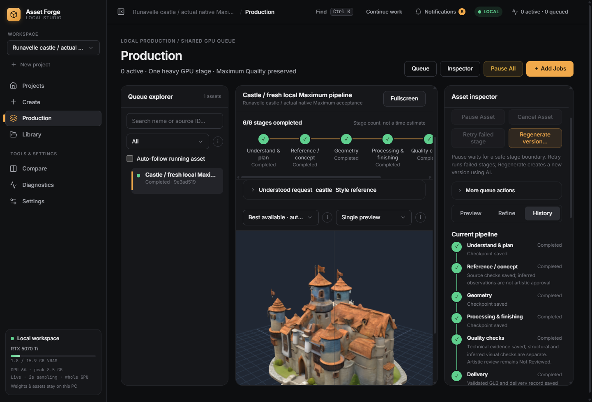

# Fresh native castle: technical delivery, art still open

Windows 0.9.17 completed an actual new local pipeline from the Vietnamese prompt
`tạo cho tôi 1 lâu đài, style giống hình ảnh ref này` and the original Archer
Tower reference to an automatically delivered GLB. Test Library and game outputs
are isolated under `.local/castle-full-native/2026-10-23T02-33-48-138Z`.
The personal Library was not reset or populated with test assets.

Actual stages:

1. Qwen3-VL `4b-instruct-q4_K_M`, CPU, correctly classified the image as a style
   reference and requested subject as castle. Immutable Vietnamese source and
   image hash remain stored. The effective derived description is separate.
2. Local SDXL Maximum 50 steps / 1024 generated the first concept. Qwen rejected
   surrounding scenery; the existing bounded repair generated a second concept,
   at the same quality. It passed the inferred composition check without human
   intervention. All attempts remain in history.
3. Existing community TRELLIS.2, stage CPU offload, 1024 cascade / 32 steps / seed
   43 / 4K PBR generated the actual new castle, not the source tower or a
   procedural blockout. Worker duration 410.14 s. Its native 15,730,718-triangle
   geometry/sparse-PBR NPZ exactly matches the retained castle master hash
   `c0a6af1ca42edaaaa6ea5daef5799d81e62212cd4d77efc711c7f7b736b57ad6`.
   Current whole-GPU sampling measured 6,661 MiB peak in 748 samples; this
   includes other device activity and can miss transients. Worker peak RSS was
   24.77 GiB and Windows private committed bytes 31.89 GiB. Torch counters are
   not claimed as an uninterrupted peak because upstream stages reset them.
4. Headless Blender performed actual processing, LOD measurements, GLB reopen
   and twelve camera/resolution combinations (six views at mobile and PC1440).
   The original/native masters, internal sources and QA reports are preserved.
   Core source-to-LOD0 PBR preservation was `Pass`: actual decoded basecolor RGBA,
   roughness/metallic channels, factors, alpha and sidedness. This is not a
   certificate of UV correspondence, all shaders or artistic quality.
5. CPU Qwen observed front/back/side renders. This is an inferred severe-defect
   screen, independent from technical validation and artistic approval.
6. Auto delivered one real embedded-PBR GLB plus optional manifest after technical
   QA, with original prompt and `not_reviewed` artistic status. No FBX/BLEND/ZIP
   or external texture files were forced into the game-facing export. Internal
   source files remain. Closing/reopening the actual Windows app retained all
   eight stage jobs, outputs and file hashes without regeneration.

Total observed production time: **994.44 seconds** (16 min 34 s). Delivery:
76,381,424 B GLB, hash
`8f1b261ab526edfea939fd9939d21c8d7eb2e53afd36216a404e3d24d469b2b4`.
The project/asset/version folder and manifest references are persisted. The
harness admits through the packaged API and inspects the actual native viewer;
it does not claim to exercise every stepped Create form control.

## Quality limits still open

The concept still has warm roofs rather than the Art Bible's midnight-blue
slate, and a flag reaches the top image boundary. Qwen's layout check missed
that detail. The model review also contains imperfect natural-language remarks,
including a contradictory limitation about the first render. These observations
are retained, not rewritten as reliable artistic certification. Neither local AI
screening nor token retention guarantees zero failures or correct style.

This establishes the real automatic technical route and preservation of the
retained native master. It does not establish the initial tower's artistic
quality on arbitrary castles, better palette fidelity, a verified back, Meshy
geometry/PBR parity, commercial clearance of every community dependency, or
user artistic approval. More geometry alone is not the quality target.

The same run exposed a separate next-job admission issue: the learned mixed
RSS/private budget required 39.67 GiB of *physical* RAM, although those counters
represent different resources. At 38.28 GiB physically available the next
identical profile was held after the first successful run. This is retained
as actual reproduction data for the separate Windows commit-admission fix.

Evidence: [complete native report](evidence/castle_full_native_v0917.json),
`desktop/verify-castle-full-native.mjs`, and retained job resources/logs/PNGs/EXRs
in the isolated run above. No full 349-GPU development batch was started.
