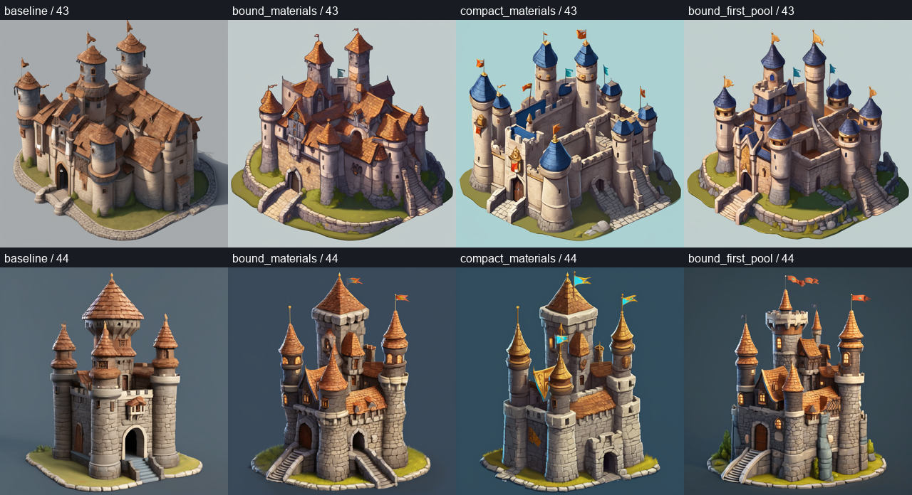

# Material binding and pooling: actual two-seed concept trials

Eight real offline SDXL concepts, same cached weights, 50 steps / 1024, guidance
7, unchanged sampler and original negative prompt, paired seeds 43/44. Existing
production sources, original prompts, masks, masters and installed environments
remain unchanged. One heavy GPU lock and host-memory admission were used. No
downloads, alternate model, cloud inference or product default was introduced.

| Variant | Actual positive tokens | CLIP windows | Explicit change |
| --- | ---: | ---: | --- |
| Baseline | 410 | 6 | Retained native castle's original compiled text; existing mean pooling |
| Bound materials | 170 | 3 | Derived image description puts roof/wall/door material assignments early; existing mean pooling |
| Compact | 68 | 1 | Shorter derived description, retaining requested subject/material vocabulary, with fewer inferred ordinary clauses; existing mean pooling |
| Bound + first pool | 170 | 3 | Same bound-material prompt; only CLIP-2 pooled vector uses first window instead of mean-all |

Original negative conditioning has 61 tokens. All positive/negative hidden-state
windows remain encoded, including empty negative windows when needed. Baseline
seed 43 exactly reproduced the previously retained concept PNG. Prompt edits
are combined changes, not a causal proof that one removed phrase or token count
caused a visible difference. All original constraints remain in research source
metadata; these experiments are not a production prompt-rewriting policy.

Observed at these seeds:

- Baseline and the longer bound-material variant both retain warm roofs.
- Compact and bound+first-pool visibly produce blue roofs for seed 43.
- **Seed 44 stays warm under all four variants.** Fewer windows or first-pool
  selection is therefore not a demonstrated universal fix.
- Geometry, composition, detail and flags also change. Blue roofs alone do not
  establish full Art Bible fidelity, safe framing, exact balcony counts or good
  downstream geometry. Some image boundaries remain too tight.

The first-pool trial uses an explicitly copied research worker, with truthful
experimental encoding diagnostics, outside production Quality Lock. Its real
full safetensor inventory is compared to the baseline. Saved resolved metadata
in that unpinned research request is not an execution-identity guarantee; the
production locked worker/policy is untouched. This does not weaken the actual
new-job identity guard.

All reports retain durations, Torch memory, whole-device VRAM/RAM samples,
tokenizer counts, prompt/checkpoint/source hashes and worker provenance. Eight
inferences took 25.13-43.23 seconds each. Whole-device samples include other
activity and can miss transients. Cache/order confound speed comparisons. No
new 3D output, artistic scoring, commercial clearance or Meshy parity follows.

Decision: **do not adopt either alternative as the default** from these two
seeds. Keep the known tower and castle sources and current production policy;
further evaluation must distinguish material/style observations from technical
QA and preserve each attempted output.

Evidence: [complete actual reports](evidence/castle_material_policy_research.json),
[bound-prompt runner](evidence/castle_material_bound_runner.txt),
[compact runner](evidence/castle_material_compact_runner.txt),
[first-pool runner](evidence/castle_material_first_pool_runner.txt).
Images and immutable requests remain under the three named `.local` run paths
inside that JSON. None are added to the user's Library.
